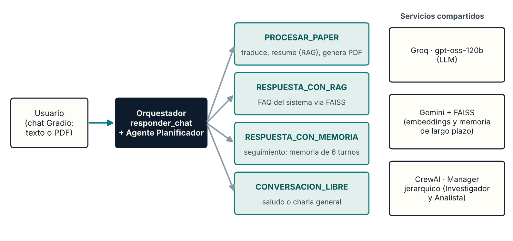
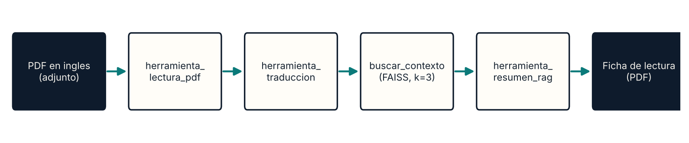

# Asistente de Investigación Académica con RAG (Evaluación Parcial 2)

Agente jerárquico con memoria, recuperación semántica y planificación adaptativa.
Proyecto de **ISY0101 · Ingeniería de Soluciones con Inteligencia Artificial** (sección ISY0101-012V).

- **Autor:** Rodrigo Concha
- **Docente:** Rodrigo Seguel

## ¿Qué problema resuelve?

Un equipo de investigación recibe papers científicos en inglés y, antes de decidir si sirven, debe traducirlos, leerlos y resumirlos a mano (entre 2 y 4 horas semanales). El agente automatiza ese filtro:

**PDF en inglés → traducción al español → resumen enriquecido con contexto RAG → ficha de lectura en PDF.**

Además conversa con el usuario, recuerda lo dicho antes en la sesión y responde sobre su propio funcionamiento usando una base de conocimiento.

## Arquitectura



El orquestador (`responder_chat`) recibe cada mensaje del chat de Gradio, reconstruye la memoria de la conversación y consulta al **Agente Planificador**, que elige una de cuatro estrategias antes de ejecutar:

| Estrategia | Cuándo se usa | Qué hace |
|---|---|---|
| `PROCESAR_PAPER` | Hay un PDF adjunto (regla dura, sin llamada al LLM) | Lee el PDF, traduce, resume con RAG y genera la ficha en PDF |
| `RESPUESTA_CON_RAG` | Pregunta sobre el propio sistema | Recupera fragmentos de la base de conocimiento (FAISS) y responde |
| `RESPUESTA_CON_MEMORIA` | Pregunta de seguimiento | Responde usando los últimos turnos de la conversación |
| `CONVERSACION_LIBRE` | Saludo o charla general (también es el fallback si el JSON del planificador es inválido) | Respuesta breve y natural |

Flujo de trabajo de `PROCESAR_PAPER`:



### Componentes y frameworks

| Capa | Elección |
|---|---|
| LLM | Groq · `gpt-oss-120b` (cliente OpenAI apuntando a la URL de Groq), con modelo de respaldo y reintento ante rate limit |
| Embeddings | Google Gemini · `gemini-embedding-001` (vectores de 3072 dimensiones) |
| Índice vectorial | FAISS (`IndexFlatL2`, en memoria) |
| Orquestación jerárquica | CrewAI · `Process.hierarchical` con `manager_llm` |
| Interfaz | Gradio `ChatInterface` multimodal (texto y PDF adjunto) |
| PDF de salida | ReportLab |

### Memoria y planificación

- **Memoria de corto plazo:** los últimos 6 turnos (`MAX_TURNOS_MEMORIA`), cada mensaje recortado a 500 caracteres, se inyectan en todas las estrategias.
- **Memoria de largo plazo / recuperación semántica:** la base de conocimiento (FAQ y papers relacionados) se indexa en FAISS; `buscar_contexto` devuelve los k fragmentos más cercanos.
- **Planificación:** patrón Plan-and-Execute. El planificador devuelve un JSON con `estrategia` y `razonamiento` antes de actuar.
- **Capa jerárquica (CrewAI):** un Manager delega en un Investigador (traduce) y un Analista (resume con RAG); cada agente usa `max_iter=3` para acotar bucles y costo.

## Estructura del repositorio

```
.
├── notebook/
│   └── chatbot_rag_investigacion_EVA_2.ipynb   # Agente completo (Colab + Gradio)
├── scripts_crewai/
│   ├── 3-multiagent_crewai_full.py             # Pipeline secuencial (3 agentes + correo simulado)
│   └── 4-multiagent_crewai_hierarchical.py     # Mismo pipeline, orquestación jerárquica
├── docs/
│   ├── diagramas/                               # Orquestación y flujo de trabajo
│   ├── evidencia_pruebas/                       # Capturas de las pruebas
│   └── papers_de_prueba/                        # PDFs ficticios en inglés para probar el agente
├── informe/
│   └── Informe_EP2_Asistente_Investigacion_RAG.docx
├── requirements.txt                             # Dependencias de los scripts de CrewAI
├── .env.example                                 # Plantilla de variables de entorno
└── README.md
```

## Cómo ejecutar el agente (notebook en Google Colab)

1. Abre `notebook/chatbot_rag_investigacion_EVA_2.ipynb` en [Google Colab](https://colab.research.google.com/).
2. En el panel lateral **Secretos** (icono de llave) crea dos secretos y actívales el acceso al notebook:
   - `GROQ_API_KEY` (se obtiene en https://console.groq.com/keys)
   - `GEMINI_API_KEY` (se obtiene en https://aistudio.google.com/apikey)
3. Menú **Entorno de ejecución → Ejecutar todas**. La celda 1 instala las dependencias.
4. Al final se levanta la interfaz de Gradio (celda 11) con un enlace local y uno público temporal.
5. Prueba en el chat:
   - `Hola` → `CONVERSACION_LIBRE`
   - `Como funciona el RAG en este sistema?` → `RESPUESTA_CON_RAG`
   - Adjunta un PDF en inglés y escribe `Procesa este paper` → `PROCESAR_PAPER` (devuelve el resumen y `ficha_lectura.pdf`)
   - `Que limitaciones mencionaste?` → `RESPUESTA_CON_MEMORIA`

   En `docs/papers_de_prueba/` hay dos PDFs ficticios en inglés (tortugas marinas y pastelería) para probar la estrategia `PROCESAR_PAPER`.

   La estrategia elegida en cada mensaje se imprime en la consola de Colab (`[Planificador] Estrategia elegida: ...`).

> Si Groq responde con rate limit (429), el sistema espera unos segundos y reintenta una vez.

## Cómo ejecutar los scripts de CrewAI (local)

Se recomienda **Python 3.11 o 3.12**: algunas dependencias de CrewAI no tienen versiones precompiladas para Python 3.14.

```bash
# 1. Entorno virtual (Windows PowerShell)
py -3.12 -m venv venv
.\venv\Scripts\activate

# 2. Dependencias
pip install -r requirements.txt

# 3. Variables de entorno: copia la plantilla y completa tu clave
copy .env.example .env      # en Linux/macOS: cp .env.example .env

# 4. Ejecutar (primero el secuencial, luego el jerárquico)
python scripts_crewai/3-multiagent_crewai_full.py
python scripts_crewai/4-multiagent_crewai_hierarchical.py
```

CrewAI puede preguntar si quieres compartir el trace de ejecución; responde `N`.

## Pruebas realizadas

| Prueba | Entrada | Resultado observado | Evidencia |
|---|---|---|---|
| Conversación libre | «Hola como estas» | Respuesta de saludo | `docs/evidencia_pruebas/01_conversacion_libre.png` |
| Memoria | «Hola me llamo Rodrigo» y luego «Como me llamo» | Responde «Te llamas Rodrigo» (en esta prueba el planificador aplicó el fallback por JSON inválido y la memoria se usó igual) | `02_memoria_corto_plazo.png` |
| Conocimiento propio | «Como funciona el RAG?» | Explica recuperación y generación | `03_respuesta_rag.png` |
| Procesar paper | PDF en inglés + «Procesa este paper» | Resumen en español de ~230 palabras con puntos clave y `ficha_lectura.pdf` | `04_…` y `05_…` |
| Decisiones del planificador | Saludo → PDF → pregunta de seguimiento | `CONVERSACION_LIBRE` → `PROCESAR_PAPER` → `RESPUESTA_CON_MEMORIA` | `06_decisiones_planificador_consola.png` |

Capturas del código relevante: `07_` (planificador), `08_` (índice FAISS), `09_` (capa CrewAI jerárquica) y `10_` (herramientas del agente).

## Uso de herramientas de IA

Se utilizó Claude (Anthropic) como apoyo en la depuración del código, en la estructura de la documentación y en los diagramas. Las ideas, el análisis y las justificaciones técnicas son propios.

## Referencias

- CrewAI. (s. f.). *CrewAI documentation*. https://docs.crewai.com
- Gradio. (s. f.). *Gradio documentation: ChatInterface*. https://www.gradio.app/docs
- Google. (s. f.). *Embeddings*. Gemini API, Google AI for Developers. https://ai.google.dev/gemini-api/docs/embeddings
- Groq. (s. f.). *GroqCloud developer documentation*. https://console.groq.com/docs
- Johnson, J., Douze, M., & Jégou, H. (2021). Billion-scale similarity search with GPUs. *IEEE Transactions on Big Data, 7*(3), 535–547.
- Lewis, P., Perez, E., Piktus, A., Petroni, F., Karpukhin, V., Goyal, N., … Kiela, D. (2020). Retrieval-augmented generation for knowledge-intensive NLP tasks. *Advances in Neural Information Processing Systems, 33*.
- Yao, S., Zhao, J., Yu, D., Du, N., Shafran, I., Narasimhan, K., & Cao, Y. (2023). ReAct: Synergizing reasoning and acting in language models. *International Conference on Learning Representations*.
